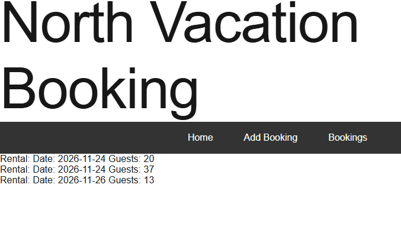

## Part 1: Classify the Findings

| Finding | Classification | Explanation |
| ------- | -------------- | ----------- |
| 1. Reservation accepts more than 12 guests  | Product defect | Application confirmed a reservation for 13 guests, even though reservation limits are supposed to be 1-12 guests. Application should reject the reservation and show an error |
| 2 No checkout date | Product defect | Booking form only allows users to select one date. Without check-out date, application cnnot validate the required stay lenth of 1-31 nights or ensure check-in occurs before checkout  |
| 3 Duplicate bookings for the same rental and date | Product defect | Application confirmed two reservations for the same rental and date without checking availability |
| 4  No booking confirmation message | Requested change | After submitting a reservation, the application provides no visible confirmation. Users must navigate to the Bookings page to verify that their reservation was saved |
| 5 Cleaning fee not displayed | Requires more investigation | Application does not display any pricing information or cleaning fees when creating or viewing reserations. Further investigation is needed to determine whether the required one-time $50 cleaning fee is being applied |

## Part 2: Write a Defect Report

| Field | Information |
| --- | --- |
| Defect ID | BUG-001 |
| Title | Reservation accepts more than 12 guests |
| Date Reported | November 22, 2026 |
| Reporter | Copper |
| Application or Feature | North Vacation Booking – Create Reservation |
| Test Environment | Local development environment, React/TypeScript application running in a web browser |
| Preconditions | Application is running and a rental is available for booking. |
| Steps to Reproduce | 1. Navigate to the "Book a Stay" page by selecting the "Add Booking" page. 2. Select a rental. 3. Select a valid date. 4. Enter 13 in the "Number of Guests" field. 5. Click "Confirm Booking". 6. Navigate to the "Bookings" page. |
| Expected Result | The application should reject reservations exceeding 12 guests and display an error message. |
| Actual Result | The application accepts the reservation for 13 guests without displaying an error. The reservation appears on the Bookings page. |
| Severity | High |
| Priority | High |
| Status | New |
| Related Requirement or Test Case | Reservations must include 1–12 guests. Invalid information must produce an error. |
| Supporting Evidence | Screenshot of the resulting reservation on the Bookings page. 
 
 |

## Part 3: Assign Severity and Priority

| Defect | Severity | Priority | Explanation |
| --- | --- | --- | --- |
| 1. Reservation accepts more than 12 guests | High | High | The application accepts reservations that violate the guest limit requirement. This could cause issues with rental capacity and availability. It should be fixed before the next release to prevent invalid reservations. |
| 2. Missing checkout date | High | High | Users cannot specify when their reservation ends, preventing the application from validating the required 1–31 night stay. This affects a major part of the booking process and should be fixed before the next release. |
| 3. Duplicate reservations for the same rental and date | High | Urgent | The application allows multiple reservations for the same rental and date, potentially resulting in double bookings. This could directly affect customers and rental availability, so it should be fixed immediately. |